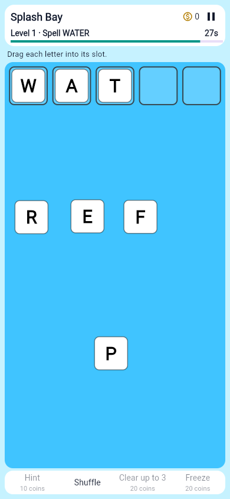
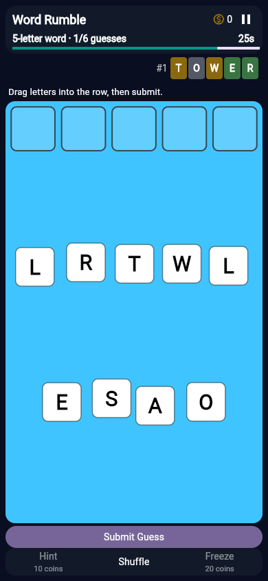

# Word Rumble gameplay audit

The audit started from `mleikam1/word_rumble` at `e9ce532` on `main`. The project metadata identifies Flutter 3.29.2. The lockfile selects Flame 1.30.1. From the project root, run `flutter pub get` and `flutter run -d chrome`. The repository also includes native Android and iOS projects.

## Baseline

- **Already present in source.** Both menu entries, the three level definitions below, the six-attempt limit, and duplicate-aware, exact-first scoring existed. The original submit method already considered a correct guess before enforcing the attempt limit.
- **Reproduced at launch.** The untouched release build opened to a blank page in Chromium. Mobile Ads initialization raised `MissingPluginException` before Flutter displayed the menu. Baseline gameplay could not be observed through that browser build.
- **Reproduced in the tools.** Baseline analysis reported three missing asset directories and a reference to a nonexistent `MyApp`. The template counter test failed to compile.
- **Found by source inspection.** An opaque HUD drew a separate board using the answer and fixed letters, displayed a hard-coded clue and currency, and offered no Submit Guess action. The engine claimed slots on overlap every frame. It stored characters without tracking which physical tile occupied each slot. Both menu buttons always opened the first level. The existing clear action removed every decoy, and Campaign never paid its configured win rewards.

## Campaign

| Reachable level | Target | Seconds | Decoys | Win reward |
| --- | --- | ---: | ---: | ---: |
| Splash Bay | WATER | 30 | 2 | 5 coins |
| Lava Core | FIRE | 25 | 3 | 6 coins |
| Wind Peak | STORM | 35 | 4 | 8 coins |

- **Fixed and tested.** A shuffled rack includes the target and the configured decoys. A tile locks on a deliberate release inside a slot. A full incorrect row stays editable. Completing the correct row awards the configured coins once and opens one result. Retry creates a fresh board. Next opens the next configured level through the UI.
- **Touch acceptance.** Spelled the incorrect row WATRE, moved the final two tiles to solve WATER, retried to a timeout, then reached and solved FIRE and STORM using the Next buttons. The clock label and progress bar were checked against the same remaining-time value. A late update after victory preserved the result and reward.

## Word Guess

- **Fixed and tested.** Each new session chooses a hidden answer from 12 common words. All answers use the same shuffled nine-tile rack, including an O and two L tiles. Retry keeps the same puzzle and resets the round. The hidden round retains the existing 30-second limit. History and the six-attempt counter come from the engine. A full row changes the attempt count only after a valid Submit Guess. A partial row or an invalid word stays editable. A correct sixth guess wins. Six misses and a timeout both reveal the answer.
- **Dictionary decision.** The checkout supplied no dictionary. Word Guess now validates offline against 8,672 five-letter entries from ENABLE2K. The rack supports 119 of them, including every possible answer. The two-word fixture dictionaries in the tests are separate from the production asset. [Dictionary source and credits](../../assets/words/README.md)
- **Feedback fixtures.** With WATER as the answer, TOWER scores yellow, gray, yellow, green, green. The W is present in the first position of WATER. With SWELL as the answer, WELLS scores yellow, yellow, yellow, green, yellow. An extra E in EATER against WATER scores gray because the correctly placed E already consumed the answer’s only copy.

## Physics, input and power-ups

| Preset | Observed behavior or source finding | Access |
| --- | --- | --- |
| Water | Displaced tiles rise toward a gently moving equilibrium and bob there. The test displaced a tile downward and measured its upward return. | Splash Bay and Word Guess |
| Lava | Gravity accelerates tiles downward at 900 logical pixels/s². Independent, timed kicks send them upward. | Lava Core |
| Wind | Oscillating horizontal force pushes the falling tiles sideways. | Wind Peak |
| Zero-G | A test-only level using the shipped Zero-G theme drifted in both axes with zero gravity. The motion code includes velocity damping. | Theme defined, no playable level |
| Ice | A test-only Ice theme hit the lower boundary at 100 logical pixels/s and rebounded upward at 80 logical pixels/s. Gravity is supplied by the theme. | Enum value only, no configured theme or level |

- **Fixed and tested.** The uppermost overlapping tile receives the drag. An occupied-slot drop or canceled drag preserves the original occupant. A free-area release removes a tile from its slot. Bounds and release speed are limited so a fast flick stays recoverable. Pause, backgrounding, resizing and Retry preserve or reset board ownership as appropriate.
- **Fixed after browser play.** On the first pass, all nine Wind tiles fell into one strip and obscured each other. Wind and Lava now settle onto spaced rows. A regression checks every pair of tiles at 0.1-second intervals for 24 seconds at 320- and 390-point phone widths.
- **Fixed and tested.** Freeze stops the round clock for five seconds. Shuffle moves only free tiles and preserves the target, occupied slots and attempt count. Hint places one real tile in a correct position. Clear up to 3 removes up to three free Campaign decoys. Existing costs are 10 coins for Hint, 20 for Freeze, 20 for Clear, and zero for Shuffle.
- **Outside this change.** Tile-to-tile impulses would be a separate gameplay feature. Original tiles had hitboxes, but the checkout had no tile-to-tile response. These presets use per-tile forces and arena boundaries. STORM uses the normal win condition.
- **Remaining.** Coins are session-only. Store and coin-pack purchases are placeholders. Native device play, native test-ad delivery, and Zero-G or Ice play through the menus are unverified.

## Verification

| Command | Result on the fix branch |
| --- | --- |
| `flutter pub get --offline` | Resolved the project dependencies, including the existing mobile ads dependency missing from the original lockfile. |
| `flutter analyze --no-pub` | No issues. |
| `flutter test --no-pub --reporter expanded` | 13 tests passed, including real Flutter touch gestures, physics, word-list, timer and lifecycle checks. |
| `flutter --no-version-check build web --no-web-resources-cdn --no-pub` | Release web build produced from `lib/main.dart`. |

### Browser playthrough

Chrome Headless Shell 134 ran the release build at 390 × 844 CSS pixels with emulated touch. Both modes were entered from the menu. In Campaign, physical drags solved WATER and FIRE, and the Next buttons opened Lava Core and Wind Peak. On the final build, all seven Lava tiles and all nine Wind tiles remained individually visible after settling. Physical drags solved FIRE and then STORM from those settled boards, for a total Campaign payout of 19 coins. A separate Splash Bay attempt reached zero on the real clock, then Retry returned to 30 seconds with empty slots and seven shuffled tiles. Pause and Resume were also exercised. In Word Guess, a partial Submit kept the counter at zero. In a round with WATER as the hidden answer, submitting TOWER produced yellow, gray, yellow, green, green. Submitting WATER next won the round.

The screenshots show the built game running in that browser. The word list and game code ran locally. The browser used cached copies of Flutter's requested fonts for the capture. Two additional browser rounds verified the six-guess boundary. Six TOWEL misses against WATER revealed the answer with four seconds remaining. A correct sixth guess of SWEAR won with two seconds remaining. A separate Word Guess timeout revealed LOWER, then Retry returned to 30 seconds, zero guesses and a clear row. The duplicate-letter fixture ran in Flutter widget tests. No physical Android or iOS device was available.

| Splash Bay after placing W, A and T | Word Guess after submitting TOWER |
| --- | --- |
|  |  |

Wind Peak after the tiles settled onto the two landing rows during the final browser run. [Wind Peak screenshot](wind-peak.png)

## Changed files

- `lib/game/word_rumble_game.dart`, `lib/game/components/letter_component.dart`, `lib/game/components/slot_component.dart` implement round state, deliberate tile placement, movement and rendering.
- `lib/game/overlays/hud_overlay.dart`, `lib/game/overlays/game_over_overlay.dart`, `lib/ui/game_page.dart` and `lib/ui/main_menu_page.dart` connect the board to navigation, controls, feedback, pause and results.
- `lib/data/guess_words.dart`, `assets/words/enable_five.txt`, `assets/words/README.md` and `pubspec.yaml` provide the offline dictionary. `pubspec.lock` records the already-declared mobile dependencies. `lib/data/level_definition.dart` drops an unused import.
- `lib/services/ad_service.dart` and `lib/ui/widgets/banner_ad_slot.dart` guard the existing mobile plugin on unsupported platforms.
- `test/widget_test.dart`, `test/round_play_test.dart`, `test/gameplay_physics_test.dart`, `test/unlisted_presets_test.dart` and `test/guess_words_test.dart` exercise both modes through real widgets, touches and the game engine.
- `docs/gameplay/` contains this audit and browser captures from both modes.
